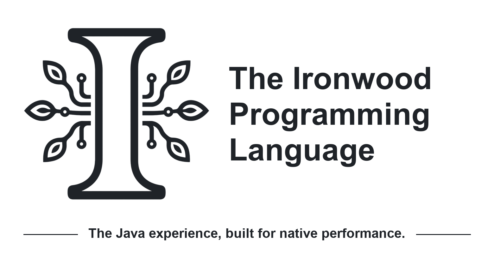

<!-- SPDX-License-Identifier: MIT OR Apache-2.0 -->

<p align="center">
  <picture>
    <source media="(prefers-color-scheme: dark)" srcset="assets/branding/ironwood-header-dark.png">
    <source media="(prefers-color-scheme: light)" srcset="assets/branding/ironwood-header-light.png">
    
  </picture>
</p>

Ironwood is an ahead-of-time compiled, object-oriented language for
high-performance native applications. It preserves the familiar Java syntax,
object model, and everyday APIs that Java developers already know, while
producing optimized native executables with explicit synchronous collection
and no JVM or JIT.
Ironwood is designed as a simpler, safer alternative to C++ without raw
pointers, borrow syntax, or an unfamiliar ownership-driven programming model.

> “Java gained its simplicity from the systematic removal of features from its predecessors.”
>
> **James Gosling and Henry McGilton**, *The Java Language Environment, 1995* (Source: [Oracle](https://www.oracle.com/java/technologies/simple-familiar.html))

> “My original goal was to build a C++ compiler that didn't have these problems.”
>
> **James Gosling**, *Interview with Bill Venners, 1999* (Source: [Artima](https://www.artima.com/articles/james-gosling-on-java-may-1999))

## Why Ironwood?

- **Performance:** Compile directly to native executables with LLVM. Closed-world
  compilation lets the compiler optimize across the whole program, with no JVM,
  JIT, or automatic collection in the generated application. Profile-guided
  optimization and a compiler-owned `@Inline` directive are on the roadmap so
  Ironwood keeps pushing the envelope for maximum performance.

- **Safety:** Ordinary references use one exact nonmoving managed heap.
  `ironwood.lang.Memory.collect()` synchronously reclaims unreachable graphs.
  Allocation never collects automatically. Close native resources explicitly
  and preserve pool reuse protocols. See [the memory contract](docs/MEMORY.md).

- **Familiarity:** Use the Java programming model you already know: classes and
  interfaces, inheritance and polymorphism, Java-width primitives, generics,
  exceptions, packages, and ordinary nullable references. Ironwood is designed
  to make Java developers feel at home from the first line of code.

## Ironwood vs GraalVM Native Image

Both Ironwood and GraalVM Native Image produce closed-world, ahead-of-time compiled native executables, but they start from different places. GraalVM Native Image compiles existing Java bytecode and carries the JVM machinery needed to preserve Java semantics into the executable. Ironwood is a separate language designed for native compilation from the ground up, with Java-familiar syntax, objects, and APIs, with explicit synchronous collection and no JVM, JIT or Java bytecode in the generated application.

> GraalVM makes Java applications native. Ironwood makes native development feel like Java.

## Quick Start

The step-by-step instructions to download, install and run are <a href="docs/QUICK_START.md">here</a>.

## Hello World

If this looks familiar, that is intentional. Ironwood keeps Java's package and
class structure while compiling your application into a native executable.
Each top-level class lives in its own `.iron` file beneath the standard
`src/main/ironwood` source root:

```text
hello/
└── src/
    └── main/
        └── ironwood/
            └── org/
                └── ironwood/
                    └── hello/
                        ├── Chatter.iron
                        └── Hello.iron
```

### Hello.iron

```java
package org.ironwood.hello;

public class Hello {

    public static void main(String[] args) {

        Chatter chatter = new Chatter();

        System.out.println("Hello " + chatter.getWord() + "!");
    }
}
```

### Chatter.iron

```java
package org.ironwood.hello;

import ironwood.util.Random;

class Chatter {

    private static final String[] WORDS = { "World", "Ironwood", "Developers" };

    private final Random rand = new Random();

    String getWord() {
        int index = this.rand.nextInt(WORDS.length);
        return WORDS[index];
    }
}
```

With `ironwoodc` on your `PATH`, run these commands from the `hello` directory:

```sh
# Compile Hello.iron; Chatter.iron is found and compiled automatically.
ironwoodc -sourcepath src/main/ironwood -d target/classes \
  src/main/ironwood/org/ironwood/hello/Hello.iron

# Link the closed-world application into an optimized native executable.
ironwoodc --link -cp target/classes \
  --main-class org.ironwood.hello.Hello -o target/hello -O3

# Run the native executable.
./target/hello
```

Each run prints one of the three greetings:

```text
Hello Ironwood!
```

The resulting `target/hello` is a native executable. It does not need the IDK (Ironwood Development Kit), Java, a JVM, a JIT, or LLVM when deployed.

## Memory Management

Ironwood manages memory like Java, but you choose when to collect the garbage.
Call `Memory.collect()` when your program has time to clean up.

You can generate garbage as needed, but aim to minimize it by pooling and reusing mutable instances. Because GC overhead is concentrated entirely in the cleanup phase, it is negligible on the critical path.

A performance-critical application must never create garbage on the critical path. If you create garbage in a loop and never call `Memory.collect(`)`, you will eventually get an `OutOfMemoryError`, because Ironwood never triggers GC implicitly.

## Object Pooling

Ironwood ships with a native object pool (<a href="docs/api/README.md">`ironwood.pool`</a>), which is paramount for hot paths without allocation. You can <a href="docs/OBJECT_POOLING.md">click here</a> for more info.


## Deterministic Cleanup with `defer`

`defer` runs cleanup when execution leaves its enclosing block (such as a method or loop body), including on return or exception, in reverse declaration order.

```java
public int readFirstByte(String path) throws IOException {
    FileInputStream fis = new FileInputStream(path);
    defer fis.close();  // Close on return and exception.
    return fis.read();  // Cleanup runs before the method returns.
}
```

Any method that returns `void` can be deferred. It works naturally with object pooling:

```java
int i = 0;
while (i < 3) {
    StringBuilder sb = pool.get(); // Borrow from an existing pool.
    defer pool.release(sb);        // Return it at the end of this iteration.
    sb.setLength(0);
    sb.append("Message ").append(i);
    System.out.println(sb);
    i++;
}
```

Use `defer` instead of a `try`/`finally` block whose only purpose is to run cleanup:

```java
// Without defer: borrow from an existing pool.
public String message(String name) {
    StringBuilder sb = this.pool.get();
    try {
        sb.setLength(0);
        sb.append("Hello ").append(name);
        return sb.toString(); // managed result survives pool release
    } finally {
        this.pool.release(sb);
    }
}
```

```java
// With defer: the same cleanup, without the try/finally nesting.
public String message(String name) {
    StringBuilder sb = this.pool.get();
    defer this.pool.release(sb);
    sb.setLength(0);
    sb.append("Hello ").append(name);
    return sb.toString(); // managed result survives pool release
}
```

## Ironwood Standard Library

Ironwood strives to provide a standard library as close as possible to the JDK, if not identical. The exception is the absence of _collections_ in favor of the highly optimized single-threaded data-structures from `ironwood.ds`. For example, you can use an `ArrayList` with the code below.

```java
import ironwood.ds.ArrayList;
import ironwood.util.Iterator;

public class ListExample {
	
	public static void main(String[] args) {
		
		ArrayList<String> list = new ArrayList<>();
		list.add("Hi1");
		list.add("Hi2");
		
		Iterator<String> iter = list.iterator();
		while(iter.hasNext()) {
			System.out.println(iter.next());
		}
	}
}
```

> For the IronDocs of the latest Ironwood Standard Library, you can <a href="docs/api/README.md">click here</a>.

## Networking Support

Ironwood's `ironwood.net` package provides a native subset of `java.net`: blocking TCP
clients and servers (`Socket`, `ServerSocket`), IPv4/IPv6 addresses, DNS, network
interfaces, and SOCKS4/5 and HTTP CONNECT proxies. It also supports TLS 1.2/1.3
clients through an optional OpenSSL dependency and includes the
[`wget` HTTP/HTTPS downloader tool](projects/wget/README.md).

See the [TCP client/server guide](docs/SIMPLE_TCP_ECHO.md) for more details and a simple example.

## Transparent Java Bridge

Ironwood native libraries can be called from Java through the Java Bridge. GC6
uses Roots constructor factories, independent RootHandle results and preacquired
ListenerRegistration owners for retaining calls. Source methods preserve their
behavior; anchor release never closes resources. See the [current API migration
and qualified platforms](docs/GC6_IMPLEMENTATION.md). The older example and
measurements below await GC7 consumer migration and do not qualify GC6 performance.

Run `ironwoodc --java-bridge` on source or compiled Ironwood inputs to produce a host jar containing the native image and Java facades. Java consumers need no handwritten JNI. The [step-by-step example](docs/JAVA_BRIDGE_EXAMPLE.md) records the earlier API; use the GC6 lifetime projection when adapting it.

## Performance Benchmark

Equivalent single-threaded OrderBook implementations on Linux. Throughput
measures 80 million operations; latency measures batches of 8,000 operations.

| Implementation | Throughput | Ironwood Advantage | Mean latency | p99 latency |
|---|---|---|---|---|
| Ironwood `-O3` | 109.49 million ops/s | baseline | 75.637 µs | 77.615 µs |
| GraalVM Native Image 25 | 87.79 million ops/s | 1.25x | 95.478 µs | 97.685 µs |
| Java Bridge (Oracle JVM 25) | 73.41 million ops/s | 1.49x | 107.125 µs | 136.924 µs |
| Oracle JVM 25 | 59.97 million ops/s | 1.83x | 135.617 µs | 163.893 µs |
| GraalVM 25 | 52.46 million ops/s | 2.09x | 154.148 µs | 165.493 µs |

The Java Bridge calls native Ironwood code from Java. Refer to the [Transparent Java Bridge](docs/JAVA_BRIDGE_EXAMPLE.md) example.

See [benchmark details](docs/BENCHMARK.md) for the workload, environment, and full results.

## Writing Automated Tests

Inspired by JUnit 5, Ironwood ships with a test framework for automated tests. You can see an example <a href="docs/TESTING.md">here</a>.

## Generating API Docs

Like JavaDocs, Ironwood has IronDocs, which generates documentation in the Markdown format. You can <a href="docs/IRONDOCS_USER_GUIDE.md">click here</a> for more info.

## Packaging Libraries

You can package compiled Ironwood classes into one .ironjar file. This is useful for distributing a library or reusing it in another Ironwood project. You can <a href="docs/IRONJAR.md">click here</a> for more info.

Normal native linking requires the verified, pinned GC SDK. Host compiler and
IDK packaging carry its source, recipes, notices and exact payload identities.
See [IDK preparation](docs/IDK.md#gc-native-inputs) and the
[GC9 qualification](docs/GC9_LINUX_X86_64_DISTRIBUTION.md). Local packaging can
set `IRONWOOD_DIST_DIR` to an isolated output directory. The package smoke
runners accept `--gc9` for focused relocation, collection and managed bridge
checks; their default release selections remain unchanged.

## Differences from Java

For the full list of Java features that Ironwood preserves, the mechanisms it adapts for native development, and the complexity it deliberately leaves behind, check <a href="docs/JAVA_EXCLUSIONS.md">this document</a>.

## Community and Feedback

Questions, use cases, design feedback, and contributions are welcome. Early feedback will help guide Ironwood’s direction.

- Use [GitHub Discussions](https://github.com/ironwood-lang/ironwood/discussions)
  for questions, ideas, and use cases.
- Open a [GitHub issue](https://github.com/ironwood-lang/ironwood/issues) for
  bugs and concrete proposals.
- See [CONTRIBUTING.md](CONTRIBUTING.md) before submitting a pull request.
- For private feedback or other inquiries, email
  [contact@ironwood-lang.org](mailto:contact@ironwood-lang.org).

## License

Ironwood is primarily distributed under the terms of both the MIT License and
the Apache License (Version 2.0), with portions covered by other licenses.

See [LICENSE](LICENSE), [LICENSE-APACHE](LICENSE-APACHE),
[LICENSE-MIT](LICENSE-MIT), and
[THIRD_PARTY_NOTICES.md](docs/THIRD_PARTY_NOTICES.md) for details.
