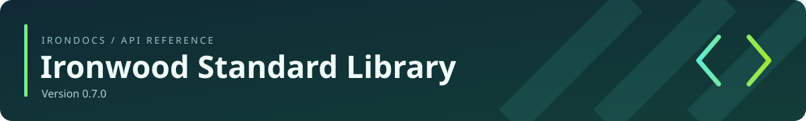

<!-- Generated by IronDocs. Do not edit. -->



**Version 0\.7\.0**

[All packages](../../README.md) / [`ironwood.net`](package-summary.md)

# SocketDescriptor

**Class** · `ironwood.net.SocketDescriptor`

```java
public final class SocketDescriptor
```

Opaque state borrowed from a [`native socket implementation`](NativeSocketImpl.md). It
exposes neither raw handles nor resource operations to applications. Delegating
implementations return their delegate's descriptor for native accept; its managed reference
retains the required graph. Its owner must close the resource explicitly.


---

Generated from Ironwood source comments with **IronDocs**.
